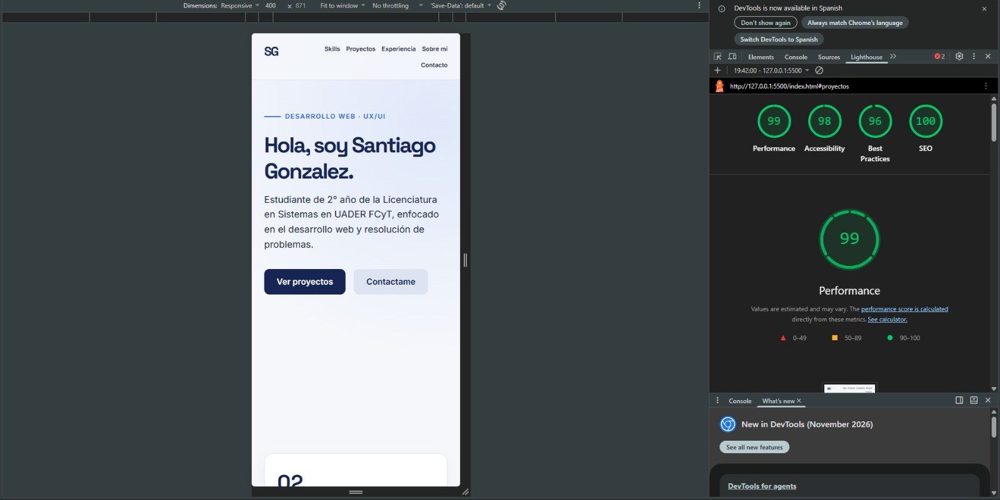

# Portfolio Web | Santiago Gonzalez

Proyecto final de maquetación web. Diseño y desarrollo de un portfolio personal accesible y responsive, construido sin frameworks.

## Tecnologías utilizadas
* HTML5 (Estructura semántica)
* CSS3 (CSS Grid, Flexbox, enfoque Mobile-first)
* Optimización de assets (Squoosh, formato WebP)

## Proceso UX/UI e Implementación
* **Paleta de colores:** Azul Naval y acento eléctrico.
* **Figma:** https://www.figma.com/design/ek5jSCeuMiuoK4F0tKVu0j/prototipo-pagina-santi?node-id=3-98&t=rnsRgOBswdWiAbHM-0
* **Sitio en vivo (Vercel):** https://portfoliowebgonzalezsantiago.vercel.app/

## ⚡ Rendimiento (Auditoría Lighthouse)
